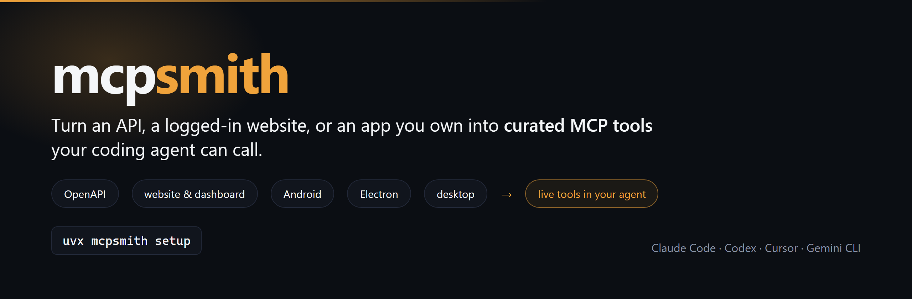
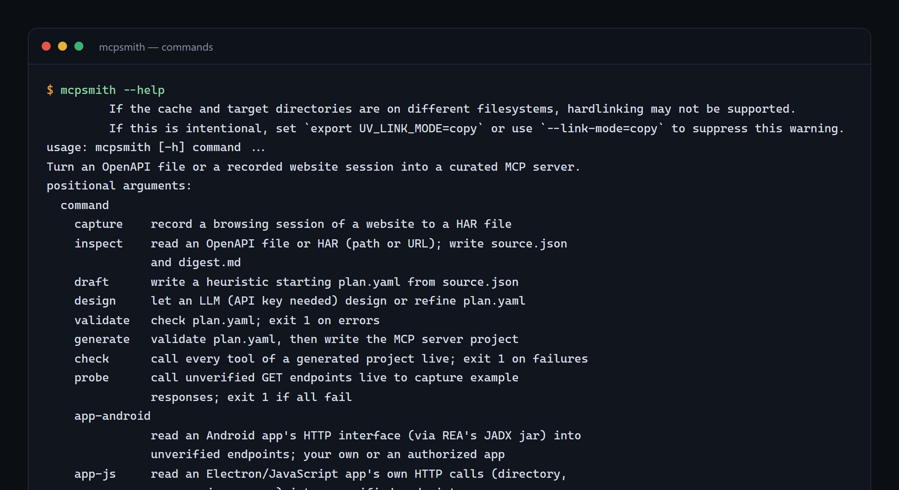
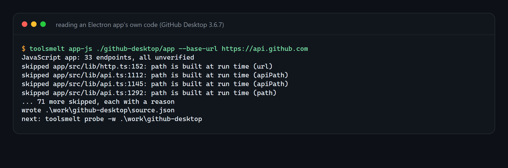
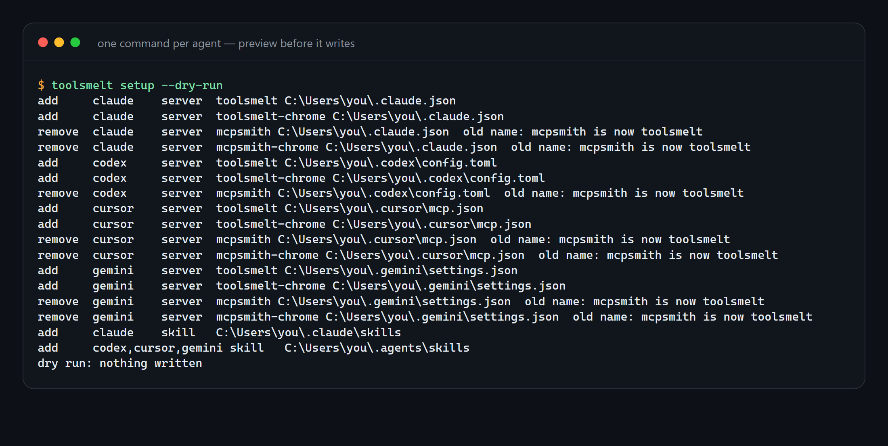

<!-- mcp-name: io.github.sepehr071/mcpsmith -->

<p align="center"></p>

# mcpsmith

Turn an OpenAPI file, a website you log in to, or an app you own into a few curated tools for your AI agent. An LLM designs the tools; you get ordinary Python code you own if you want to publish them.

```bash
uvx mcpsmith setup
```

## What you can turn into tools

| Source | Command |
|---|---|
| OpenAPI / Swagger file or URL | `mcpsmith inspect <file-or-url>` |
| Website or logged-in dashboard | `mcpsmith browser`, then your agent records it (`mcpsmith capture <url>` records a HAR without the hub) |
| Android app (APK you own) | `mcpsmith app-android app.apk --base-url https://api.example.com` |
| Electron / JavaScript app | `mcpsmith app-js <dir\|app.asar\|file> --base-url https://api.example.com` |
| Desktop program | `mcpsmith app-desktop` (prints the mitmproxy steps), then `mcpsmith app-desktop capture.har --host api.example.com` |

Apps and programs: only software you own or are authorized to analyze.

<p align="center"></p>
<p align="center"><em><code>mcpsmith --help</code>: the command list.</em></p>

## Quickstart: a logged-in website

```bash
uvx mcpsmith setup                  # once: registers mcpsmith + Chrome DevTools MCP with your agents
uvx mcpsmith browser                # opens the shared Chrome; log in to the site yourself
# restart your agent, then ask it:
#   "Record example.com in the shared Chrome and connect it as tools."
# the extract-api skill runs the rest: record, inspect, design, validate, connect
```

Your passwords and 2FA codes never reach the agent. Details are under [Live hub](#live-hub).

## Proven on real software

- **Tusky 29.0** (open-source Android client, Retrofit): `mcpsmith app-android` found 113 endpoints with every HTTP method resolved (48 GET, 43 POST, 11 DELETE, 8 PUT, 3 PATCH) and no unresolved notes. Minified annotation names were resolved from the app's own request-builder class, not guessed.
- **GitHub Desktop 3.6.7** (Electron): `mcpsmith app-js` found 33 endpoints with every method resolved. All 33 were traced to their original TypeScript line through the app's source maps.
- **hn.algolia.com** (public API, no login): recorded in the shared Chrome. 2 curated tools were connected through the hub and returned live results. The tools were still present after restarting the hub.
- **An internal attendance dashboard** (ASP.NET, cookie login): recorded while logged in. 2 tools answered the owner's questions. After logout the tools return a clear session-expired error.

Numbers are from runs on 2026-10-21 with mcpsmith 0.4.0. Reproduce the first two with `mcpsmith app-android` and `mcpsmith app-js` on those apps.

<p align="center"></p>
<p align="center"><em><code>mcpsmith app-js</code> reading an Electron app's own code.</em></p>

## For coding agents

No API key needed: your coding agent is the designer.

- Skills (plain Markdown, any agent can read them): [`skills/build-mcp-server`](skills/build-mcp-server/SKILL.md) (the whole workflow), [`skills/extract-api`](skills/extract-api/SKILL.md) (logged-in sites into live tools), [`skills/design-mcp-tools`](skills/design-mcp-tools/SKILL.md) (design checklist). [`AGENTS.md`](AGENTS.md) points Codex, Cursor and Gemini CLI at them.
- MCP tools (paths absolute): `smith_guide`, `smith_inspect`, `smith_app_android`, `smith_app_js`, `smith_app_desktop`, `smith_probe`, `smith_draft`, `smith_validate`, `smith_generate`, `smith_check`, `smith_install`, and for the hub `smith_record_start`, `smith_record_stop`, `smith_connect`, `smith_disconnect`, `smith_connections`, `smith_login`, `smith_tools`, `smith_call`.
- MCP config, any client:
  ```json
  {"mcpServers": {"mcpsmith": {"command": "uvx", "args": ["mcpsmith", "mcp"]}}}
  ```
- Claude Code plugin (skills + MCP server): `/plugin marketplace add sepehr071/mcpsmith`, then `/plugin install mcpsmith@mcpsmith`.

MCP clients start servers without your shell's proxy variables. Behind a proxy, add `"env": {"HTTPS_PROXY": "http://127.0.0.1:8080"}` so `smith_inspect` can fetch specs.

## Live hub

Skip the project: connect a plan and its tools appear in your agent right away. The mcpsmith MCP server is the hub. Connections are saved under `~/.mcpsmith` (`MCPSMITH_HOME`) and load again on restart. They are personal (one machine, one user); `generate` stays the way to publish.

From the agent: `smith_inspect`, edit `plan.yaml`, `smith_validate`, then `smith_connect(workdir, name)` and call the new tools. If your client does not show tools added after start, use `smith_tools(connection)` and `smith_call(connection, tool, args)` (read-only tools only). `smith_connections` lists, `smith_disconnect(name)` removes (CLI: `mcpsmith connections`).

### Logged-in sites

For a dashboard or portal with no public API, the agent records the site's own calls while you use it. The `extract-api` skill runs the whole flow.

```bash
mcpsmith browser                                                      # shared Chrome on port 9222 (--port N, --no-proxy)
npx chrome-devtools-mcp@1.11.0 --browser-url=http://127.0.0.1:9222    # point Chrome DevTools MCP at it
```

1. Log in yourself in that Chrome window (passwords and 2FA never reach the agent).
2. The agent calls `smith_record_start(name, hosts)`, browses each feature twice with different inputs, then `smith_record_stop(name)`, which writes a HAR with cookies and tokens dropped.
3. It inspects, designs and connects the plan with `auth: {type: browser, login_path: /login}`. Calls reuse your Chrome session; when it expires the tool says to log in again.

Agents must not use DevTools `get_network_request`: it prints request headers, including cookies. `generate` refuses browser-auth plans because they only work with your Chrome; switch to token or API-key auth to publish.

### Websites without the hub

```bash
pip install "mcpsmith[capture]" && playwright install chromium
mcpsmith capture https://example.com -o site.har --host example.com   # browse, then close the tab
mcpsmith inspect site.har --host example.com
mcpsmith draft --name example-mcp
# redesign plan.yaml, then validate, generate, check as under Export & publish
```

While recording, do each thing you want as a tool: search, open a detail page, paginate, apply a filter. Anything you do not click is not in the capture. `--host` (repeatable) keeps only the hosts you list. A DevTools "Save all as HAR" export works in place of `capture`. The recording browser uses `HTTPS_PROXY` when it is set.

A HAR holds everything the browser sent and received, including cookies and your personal data: keep it out of git and delete it after `inspect`. `inspect` scrubs what it keeps: an API key or token becomes an `auth` env var with its value dropped, other secret-looking headers and query params are dropped, and emails, phone numbers, JWTs and values under secret or personal field names are masked in examples and test fixtures. This is pattern-based, so read `tests/fixtures/` before you publish a generated server. If a key is a public one the site sends to every visitor (a search or maps key), you may put it in the tool's `fixed` values.

### Apps and programs

Only for software you own or are authorized to analyze.

- Desktop program: `mcpsmith app-desktop` prints the steps to record its traffic with your own mitmproxy (`mitmdump --set hardump=capture.har`); `mcpsmith app-desktop capture.har --host api.example.com` imports the result. mcpsmith runs nothing for you, and certificate-pinned programs are out of scope.
- Android app: `mcpsmith app-android app.apk --base-url https://api.example.com` reads the app's Retrofit interface. It needs a decompiler: the free [`jadx`](https://github.com/skylot/jadx/releases) CLI on PATH (`scoop install extras/jadx`, `brew install jadx`), or REA's JADX jar (`REA_JADX_MCP_JAR`). Without `--class` it lists candidate classes. Before decompiling it triages the APK in about a second (zip listing and dex bytes): a Flutter or React Native app, or one without Retrofit, gets its next step right away (record its traffic, or `app-js` on a React Native JS bundle), and a known request-signing SDK names the sign-in provider to use.
- App that signs its own requests: plans use `auth: {type: signin, provider: xiaomi}` (Mi Home cloud is the first provider). The user signs in on the provider's own page through a link from the server's `<prefix>_login` tool (`smith_login` in the hub); the session goes to the OS keychain. Calling the login tool again names the account and where its data is, which catches a wrong account or region.
- Electron/JavaScript app: `mcpsmith app-js <dir|app.asar|file> --base-url ...` reads the calls in its shipped code.

Neither `app-android` nor `app-js` runs the app. The endpoints are unverified (no example response) until `mcpsmith probe` calls the GET ones live with your credentials (`--writes` for the rest, only after you agree). A method that cannot be read stays empty and `validate` refuses it.

## Setup

`uvx mcpsmith setup` registers the `mcpsmith` and `mcpsmith-chrome` (Chrome DevTools) MCP servers, and copies the skills into each coding agent it finds (Claude Code, Codex, Cursor, Gemini CLI). Options:

- `--dry-run` prints the plan and writes nothing.
- `--agents claude,codex` limits it to those agents (default: the ones found).
- `--rea` also installs REA (`rea-agents`). It is off by default: its MCP server adds about 200 tools to each agent, and mcpsmith's app path needs only plain tools such as `jadx`.
- `--no-skills` skips the skills; `--yes` skips the confirmation.
- `--remove` undoes what setup did. Entries and skill folders you made yourself are left alone. REA stays installed (you may have had it before); the command prints the line that removes it.

Before setup first changes a config file, it copies the file to `*.mcpsmith.bak`. The backup is made once and not refreshed by later runs. Restart your agents afterwards. Run `mcpsmith browser` before using Chrome DevTools: it starts the shared Chrome the server connects to.

Claude Code plugin users already get both servers from the plugin and do not need `setup`.

`mcpsmith install <project>` registers a server made by `generate` with the same agents, the same way: it runs the project folder (`uv run --directory`), or the released package with `--pypi`. It touches only the entry named after the plan and refuses one of that name that runs something else unless `--force`. `--remove` takes it out again.

<p align="center"></p>
<p align="center"><em><code>mcpsmith setup --dry-run</code> prints what it would change and writes nothing.</em></p>

## Transforms

Plans convert formats with `transform` on arguments, `output.transforms` (`date->unix`, `date->unix_end`, `unix->date`, `unix->datetime`, `minutes->hh:mm`, `toman->rial`, `rial->toman`, `int->str`, plus optional Jalali calendar conversions) and `timezone` (IANA name; empty means the system's local zone).

## Secrets

Credentials come from you, never the chat: `mcpsmith secret set <connection> <ENV_NAME>` asks with a hidden prompt and stores the value in the OS keychain (`--once` forgets it after one use, for one-time codes; `list` and `delete` also exist).

## Export & publish

To turn a plan into a standalone server project instead of a hub connection:

```bash
uvx mcpsmith inspect https://petstore3.swagger.io/api/v3/openapi.json   # .mcpsmith/source.json + digest.md
uvx mcpsmith draft --name petstore-mcp                                  # heuristic .mcpsmith/plan.yaml, no LLM
# redesign plan.yaml (your coding agent does this, or use `design`, see below)
uvx mcpsmith validate
uvx mcpsmith generate -o petstore-mcp
cd petstore-mcp && uv run pytest
uvx mcpsmith check .                                                    # call every tool live
uvx mcpsmith install .                                                  # register it with your agents
```

A spec read from a local file may only have a relative server URL; `validate` then asks you to set an absolute `base_url` in the plan.

### Let mcpsmith call an LLM

```bash
uvx mcpsmith design --goal "find products, compare prices, read reviews" --provider anthropic
```

Providers: `anthropic` (`ANTHROPIC_API_KEY`), `openai` (`OPENAI_API_KEY`), `openrouter` (`OPENROUTER_API_KEY`), `ollama` (no key). `--model` picks the model; `MCPSMITH_MODEL` and `MCPSMITH_BASE_URL` override the model and endpoint. The result is the same `plan.yaml`; review it before `generate`.

### How it works

```
openapi.yaml | site.har --inspect--> source.json + digest.md
                        --draft----> plan.yaml     (heuristic starting point)
   your agent edits plan.yaml, or `design` ------> plan.yaml
                        --validate-> issues
                        --generate-> <name>/       (server project)
                        --check----> live report per tool
```

`Source` is what the API offers; `Plan` is the server to build; code generation reads the plan plus captured responses for test fixtures. A plan, trimmed:

```yaml
name: shop-mcp
description: Search products and compare prices on Example Shop.
prefix: shop
base_url: https://example.com/api
env_prefix: SHOP_MCP
instructions: Search first, then fetch details with the id. Prices are in toman.
tools:
  - name: shop_search
    title: Search products
    description: Returns matching products with price and stock. Use shop_product for full details.
    endpoint: GET /v2/search
    args:
      - {name: query, type: string, required: true, description: "Search words, e.g. 'laptop'", to: query.q}
      - {name: max_price, type: integer, description: "Upper price limit in toman, e.g. 20000000", to: query.price_max}
      - {name: sort, description: "Result order.", map: {cheapest: price_asc, newest: date_desc}, default: cheapest, to: query.o}
    output:
      root: data.products
      fields: {id: id, title: title_fa, price: price.selling_price, in_stock: stock.available}
      max_items: 10
    example: {query: laptop}
```

Argument targets (`to:`): `path.<n>`, `query.<n>`, `header.<n>`, `cookie.<n>`, `body`, `body.<a.b.c>`. Output paths use dots, a number indexes a list (`images.0.url`), `[]` maps over a list (`tags[].name`). `map` turns friendly values the model sees into the cryptic ones the API wants.

### What you get

```
<name>/
  pyproject.toml  server.json  README.md  LICENSE  .gitignore  mcpsmith.yaml
  src/<package>/server.py        # tools, built on mcpsmith.runtime
  tests/                         # replay captured responses; one -m live test per tool
  .github/workflows/             # ci.yml, publish.yml (PyPI + MCP Registry)
  .claude-plugin/plugin.json     # Claude Code plugin
  skills/<name>/SKILL.md         # skill for the generated server
```

`mcpsmith.yaml` is the plan, so you can regenerate. To publish: add a PyPI trusted publisher (workflow `publish.yml`, environment `pypi`), bump the version in `pyproject.toml` and `server.json`, tag `v*`.

### Drift check

`mcpsmith check <project> [--json]` calls every tool with its example arguments and reports errors, output size in characters and output fields that came back empty. Run it nightly in CI to see when an API or site changes. It makes real calls, so tools marked `read_only: false` are skipped unless you pass `--writes`.

## Runtime features

Generated servers import `mcpsmith.runtime`, so a fix there reaches every server on upgrade.

- Retries on network errors, timeouts, 429 and 5xx (writes only on 429, so they are never sent twice); `Retry-After` honoured and capped; jitter; concurrency cap.
- GET response cache, host allowlist, 5 MB body cap.
- Proxy support: `<P>_PROXY` takes one URL or a comma list (pool). `<P>_BASE_URL` overrides the base URL. System proxy env vars are ignored on purpose.
- Chrome TLS fingerprint for sites that block plain clients: `pip install "mcpsmith[stealth]"` and `impersonate: true` in the plan. Without the extra it falls back to plain httpx with one warning.
- Compact output: `shape()` keeps only the planned fields, caps lists (reports the total count), clips long strings, drops nulls.
- Actionable errors: a 403 suggests setting `<P>_PROXY`, a 401 names the auth env var, 404/429/5xx say what to do next.
- Auth: bearer, header, query, cookie or basic, read from an env var.

## Comparison

Most generators mirror every endpoint as a tool and hand the model raw JSON. mcpsmith designs a few workflow-level tools with plain argument names, descriptions that say when to call what next, and compact output.

| | Input | Output | Tool design | Response shaping | Drift check | Open source |
|---|---|---|---|---|---|---|
| mcpsmith | OpenAPI, HAR, app code | live hub tools or Python MCP project | LLM-designed plan | per-tool root/fields/max_items | `mcpsmith check` | yes |
| FastMCP `from_openapi` | OpenAPI | runtime proxy | one tool per endpoint; manual route maps / transforms | raw JSON | no | yes |
| openapi-mcp-generator | OpenAPI | TypeScript server | one tool per endpoint; `x-mcp` to pick | raw JSON | no | yes |
| Speakeasy / Gram | OpenAPI | TypeScript or hosted | manual toolsets | experimental | no | Gram yes |
| Stainless | OpenAPI | npm package | code mode (search + execute) | n/a | no | no |
| mitmproxy2swagger, har-to-openapi | HAR / traffic | OpenAPI spec | none | none | no | yes |
| Integuru, reverse-api-engineer | HAR / browsing | API client code, not MCP | none | none | no | yes |
| Supergood, Wire | site walkthrough | hosted API / MCP | managed | managed | vendor claims | no |

Compiled from each project's public docs in October 2026; check them before relying on a cell. FastMCP's own docs say curated servers clearly beat auto-converted ones.

## Limitations

- No browser per call: JS challenges and captchas are out of scope. Sites that need them will fail at `check`.
- A tool maps to one request. Multi-call workflow tools need hand edits to the generated `server.py`, and regenerating overwrites them.
- The generated project is Python only.
- A HAR only contains what you did while recording; unrecorded features are not in the plan.
- Endpoints read from app code are unverified until `probe`; a method that cannot be read stays empty.
- Request bodies are sent as JSON; endpoints that only accept `application/x-www-form-urlencoded` or multipart need a hand edit.
- The plan is trusted input: its text ends up in server instructions and the skill, and `mcpsmith check` runs the generated code. Review a plan written by an LLM from third-party content before you generate and publish it.
- Alpha.

## Develop

```bash
uv sync
uv run pytest -q
uv run ruff check .
```

See [CONTRIBUTING.md](CONTRIBUTING.md) and [docs/design.md](docs/design.md).

## License

MIT
